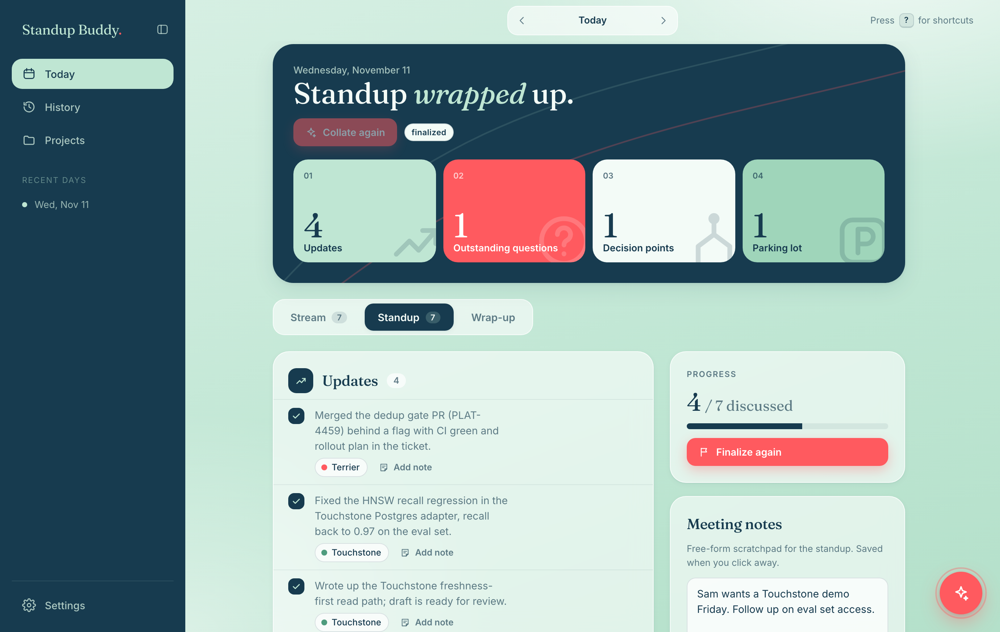
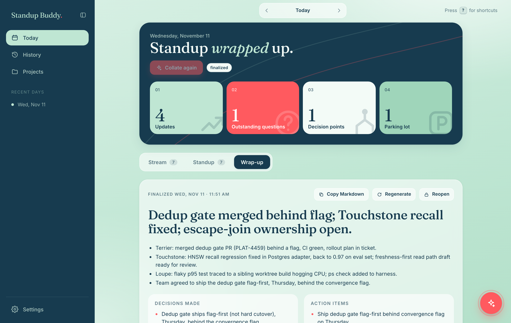
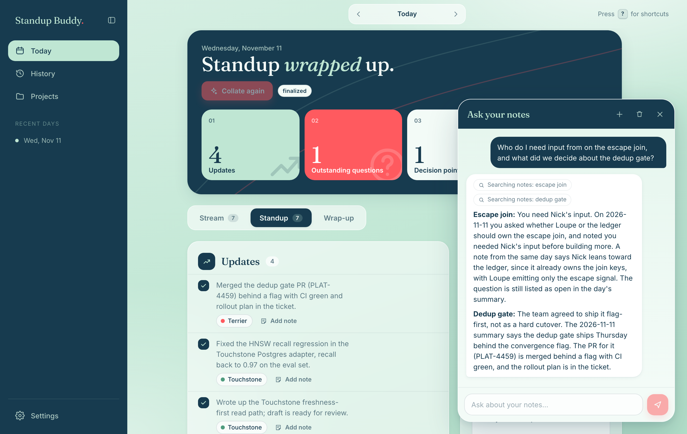

# Standup Buddy

A web app for daily standups. Log a stream of consciousness through the day, tag it to projects, **collate** it into standup bullets with Claude Haiku 5.5, add notes while each point is discussed, **finalize** the standup into a summary, and ask an agent questions about all of your notes.



## What it does

- **Stream.** Jot things down as they happen and tag each entry to one or more projects.
- **Collate.** One click turns the day's stream into four lists: updates, outstanding questions, decision points and a parking lot. Points are grouped under short themes, and each carries a **why** note: a talking point explaining why it is on the board, grounded in your stream entries (click it to edit). Re-collating keeps anything you edited, checked off, annotated or added yourself.
- **Standup.** Run the meeting from the board. A category bar with counts (All, Updates, Questions, Decisions, Parking lot) filters it as you walk through. Check points off as they are discussed and add timestamped notes to each one, plus a free-form meeting notepad.
- **Finalize.** After the standup, the LLM folds your notes into a summary with decisions made, action items, follow-ups and carry-over. Copy it as Markdown.
- **Todos.** A todo list (title, description, project, due date) in a drawer that slides in from the right. Open it with the checklist button beside the chat button (it shows the open count) or press `D`; close it with `Esc`, the close button or a click outside. On desktop (1024px and wider) the **pin** button docks it as a second column and the page resizes beside it. Descriptions show two lines and expand on click, and due dates read "tomorrow" or "Friday" with the full date on hover (turn this off under **Settings → Todos**). Deleting asks for confirmation, and completed todos record when they were finished.
  - **Urgency.** Each todo has an urgency from 1 (not urgent, the default) to 5 (incredibly urgent), set under **Details**. It shows as a flame that grows, warms from yellow through orange to red and flickers faster as urgency rises, and from 2 up the row gets a progressively stronger gradient. AI clients can set it with `add_todo`'s `urgency`.
  - **Search, filter, sort.** Above the list: search by text (title, description and project name), filter by project and by a date range (on due date or date added), and sort by urgency, due date, date added or project, with a button to reverse the direction. Undated and project-less todos always sort last. These controls only change what the drawer shows; they reset on reload.
  - **From the standup.** Every Action Items row has an add-todo button, and finalizing also suggests todos with **Quick add** and **Add all**. Adding opens the drawer and pulses the new todo. Each todo shows its source (manual, action item or suggestion) and, for standup todos, the date of that standup as a link back to its wrap-up.
  - **In the summaries.** Todos created or completed on a day feed that day's collation (finished todos become updates) and its summary, and **Insights** shows todos created and completed per week.
- **Days.** Every day is stored on its own: its stream, collated points, notes and summary. Browse and search them under History.
- **Insights.** A week view of what got done: updates per day with the change from the previous active day, whether the week is trending up or down, totals against last week, todos created and completed, and activity per project. **Weekly recap** has the LLM read the week's standups and sort them into successes, misses, opportunities and risks, laid out as a SWOT matrix (strengths = successes, weaknesses = misses). The numbers are computed in the API; only the recap uses the model, and it reuses the finalize model.
- **MCP server.** Let an AI client such as Claude Code check the day's status, add stream entries and standup items, trigger a collation, add notes to items, finalize the standup, manage todos, and read stream items, standup items and summaries by day. See [MCP server](#mcp-server).
- **Ask your notes.** A chat agent searches everything you have recorded and answers with the day cited. Conversations are multi-turn and persist.





## Run it

You need Docker. Then:

```bash
cp .env.example .env      # optional: set ANTHROPIC_API_KEY and change the secrets
docker compose up --build
```

Open <http://standup.buddy.localhost:8080> (or <http://localhost:8080>). Chrome resolves `*.localhost` to your machine with no hosts entry, and treats it as a secure origin, so there is no "Not secure" warning and the app can be installed. If you did not put a key in `.env`, add it under **Settings**. It is stored AES-256-GCM encrypted in Postgres, keyed by `APP_SECRET`.

The app has **no login** and is bound to `127.0.0.1` on purpose. Do not expose it to a network as is.

Stop it with `docker compose down`. Your data lives in the `pgdata` volume; add `-v` to wipe it.

## Install as an app (PWA)

Standup Buddy is an installable PWA: web manifest, icons and a service worker that keeps the UI shell available offline (data requests always go to the network).

1. Open **<http://standup.buddy.localhost:8080>** in Chrome.
2. Click **Install** in the address bar, or ⋮ → **Cast, save, and share** → **Install page as app**.

Use the `.localhost` address (or `localhost`) rather than a custom `*.local` name. Chrome only offers installation, and only hides the "Not secure" warning, on a secure origin, and plain-HTTP `*.local` hostnames are not one. They also hit a slow mDNS lookup on macOS. Installs from different addresses are separate apps, so pick one.

## MCP server

The Go API serves an [MCP](https://modelcontextprotocol.io) endpoint (streamable HTTP, official Go SDK) so an AI client can drive Standup Buddy. It starts with `docker compose up` and is served through the web port at `http://localhost:8080/mcp`. **Settings → MCP server** has copy-ready setup for Claude Code, Cursor/VS Code and Claude Desktop.

```bash
claude mcp add --transport http standup-buddy http://localhost:8080/mcp
```

| Tool | What it does |
| --- | --- |
| `get_day_status` | Status and counts for a day (default today) |
| `add_stream_entry`, `add_standup_item` | Add to the stream, or straight to the board as an update, question, decision or parking-lot item |
| `collate_day` | Trigger a collation |
| `add_item_note` | Add a note to a standup item |
| `finalize_standup` | Finalize the standup into its summary |
| `add_todo`, `list_todos`, `delete_todo` | Manage todos |
| `get_stream_items`, `get_standup_items`, `get_standup_summaries` | Read by `date`, or by `from`/`to` range |
| `list_projects` | Project ids for tagging |

The tools call the same store and jobs as the web UI. "Today" uses the API container's time zone, so set `TZ` in `.env` (for example `America/New_York`). Set `MCP_TOKEN` in `.env` to require `Authorization: Bearer <token>`. Like the app, it has no login otherwise and is bound to `127.0.0.1`.

### Sample prompts

Once connected, ask in plain language. The client picks the tools:

- What's the status of my standup today?
- Add to my stream: finished the migration review, waiting on Sam for sign-off. Tag it to the Platform project.
- Add a decision item to today's standup: we ship the API change behind a flag first.
- Collate today's stream into standup points, then show me the questions and decisions.
- Add a note to the standup item about the migration: Sam will review by Thursday.
- Finalize today's standup and list the action items.
- Add a todo to write up the rollout plan, due next Friday.
- Show my open todos and delete the one about the old dashboard.
- What did I work on last week? Read my stream items for Monday to Friday.
- Show me the standup summaries for the last three days and pull out anything that carried over.

The client looks up project ids with `list_projects`, and item ids with `get_standup_items`, so you can refer to projects and points by name.

## Quick note popup (global hotkey)

A Spotlight-style popup for capturing a stream note from any app. A browser can't register a system-wide hotkey itself, so the pieces are:

- **`/capture`**: a tiny page with just a note box and project chips. `Enter` saves the note to today's stream and closes the window, `Shift+Enter` adds a new line, `Esc` closes. The projects you pick are remembered.
- **`scripts/quick-capture.sh`**: opens `/capture` as a small, centered Chrome app window (no tabs or address bar).
- **A macOS shortcut** that runs the script when you press a hotkey.

Set up the hotkey once:

1. Open the **Shortcuts** app and create a new shortcut with a **Run Shell Script** action containing the absolute path to the script, for example `/Users/you/Projects/standup-buddy/scripts/quick-capture.sh`.
2. Open the shortcut's details (ⓘ) and choose **Add Keyboard Shortcut**, then press your combination, such as `⌃⌥Space`. Avoid `⌘Space`, which is Spotlight.

Alternatives: an Automator **Quick Action** with a keyboard shortcut under System Settings → Keyboard → Keyboard Shortcuts → Services, or a hotkey command in Raycast or Alfred.

The script reads `STANDUP_BUDDY_URL`, `CAPTURE_WIDTH` and `CAPTURE_HEIGHT` from the environment, and `DRY_RUN=1` prints the Chrome command instead of running it. The installed app also lists **Quick note** as an app shortcut (right-click its icon).

## Keyboard shortcuts

Single keys work anywhere except while typing in a field, so they never collide with browser shortcuts such as `⌘N`, `⌘T`, `⌘S` or `⌘J`. Press `?` in the app for the full list.

| Key | Action |
| --- | --- |
| `⌘/Ctrl` `K` or `C` | Toggle the chat |
| `D` | Toggle the todo drawer |
| `N` or `/` | New stream note |
| `T` / `H` / `I` / `P` / `S` | Today / History / Insights / Projects / Settings |
| `[` / `]` | Previous / next day |
| `1` `2` `3` | Stream / Standup / Wrap-up tab |
| `Shift` `C` / `Shift` `F` | Collate day / Finalize standup |
| `?` | Show shortcuts |
| `Esc` | Close the chat or dialog, or leave a text field |

## Architecture

| Service | Tech | Role |
| --- | --- | --- |
| `web` | React 19 + Vite, `@flue/react`, nginx | UI; nginx proxies `/api` and `/agents` |
| `api` | Go (`net/http`, pgx, MCP Go SDK) | All data, prompts, settings, search and the `/mcp` endpoint; migrations run on every start |
| `agent` | Node, [Flue](https://flueframework.com) 2.3 | LLM agents: collator, finalizer and the multi-turn notes assistant |
| `db` | Postgres 17 | App data and Flue's conversation tables |

- **Collate and finalize.** The Go API builds the prompt from the day's data and calls the agent service. A Flue agent returns its result through a terminating tool call (`submit_collation`, `submit_summary`), which the API validates and saves.
- **Ask your notes.** The browser talks to the Flue `notes-assistant` agent directly through `useFlueAgent`. Its tools (`search_notes`, `get_day`, `list_days`, `list_projects`) call back into the Go API. Conversations are durable in Postgres.
- **MCP.** The Go API mounts a stateless MCP endpoint at `/mcp` (nginx proxies it). Its tools call the same store and jobs as the UI, so there is no second copy of the logic. Setup instructions are under **Settings → MCP server**.
- **Settings.** The friendly-due-dates toggle (saved in the browser), model per task (default `claude-haiku-5-5`), thinking level, tool toggles, extra prompt instructions and the API key. The agent service re-reads them from the API on each request.
- **Layout.** Every view shares one content width. The sidebar collapses to an icon rail, and below tablet-portrait width the nav moves to the top.

Set `ANTHROPIC_BASE_URL` to route model calls through a gateway or proxy.

## Develop without Docker

```bash
docker compose up db -d                      # Postgres only (publish 5432 yourself if needed)
(cd api   && go run .)                       # :8080, DATABASE_URL / AGENT_URL via env
(cd agent && npm install && npm run dev)     # :3000
(cd web   && npm install && npm run dev)     # :5173, proxies /api and /agents
```

## Repository layout

```
api/     Go API (MCP tools in mcp.go); SQL migrations in api/migrations (embedded, applied on start)
agent/   Flue app: src/agents/*, src/app.ts (routes), src/db.ts (Postgres adapter)
web/     React UI
docs/    Screenshots used in this README
```

## Notes

`@earendil-works/pi-ai` is pinned to 1.4.0 in `agent/package.json`: Flue 2.3.0 resolves a newer 1.5.x that no longer exports what it imports.
